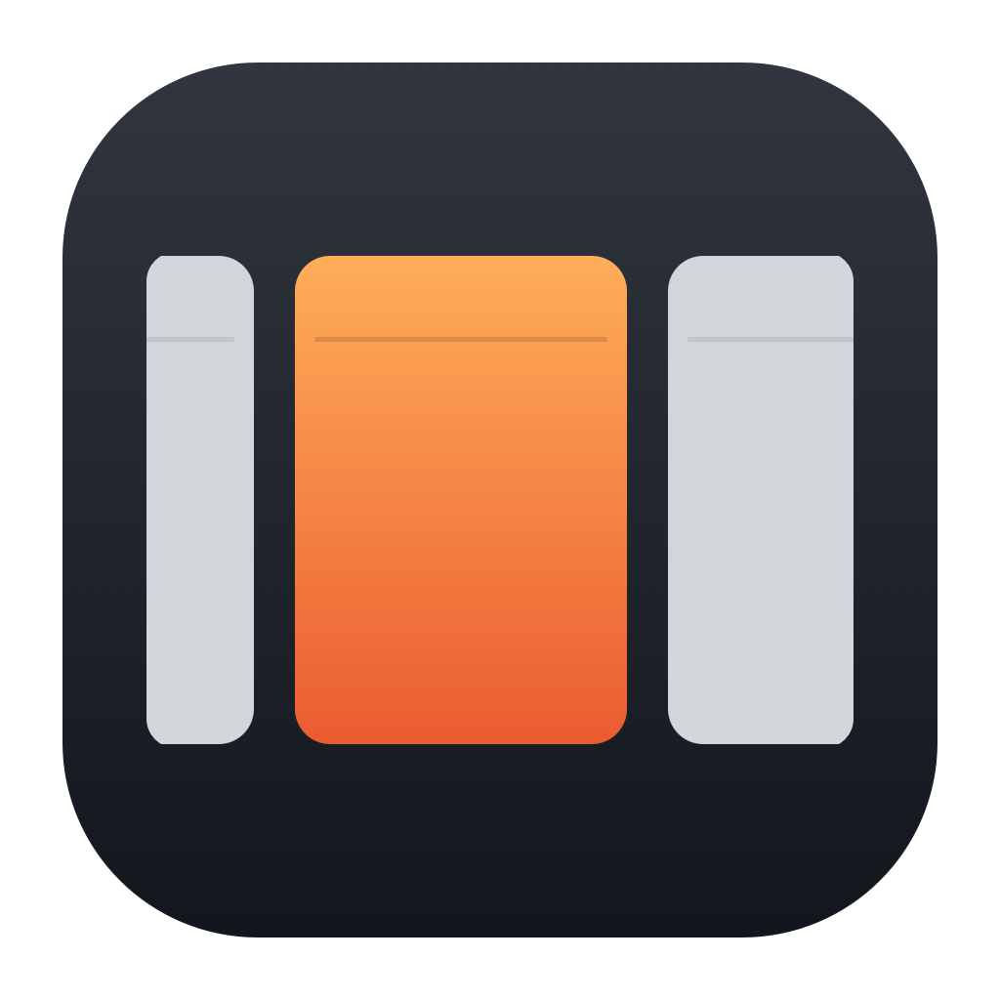

# TileMe



A free, open-source scrolling window manager for macOS.

I wanted a better way to see my open windows without constantly rearranging them or shrinking everything to fit. TileMe puts them side by side in a row. When the row gets wider than the screen, you move along it.

The idea came from TileMyMac. This is my own implementation, built with Swift, SwiftUI, and AppKit, and released under the MIT license.

## What it does

- New windows join the row after the one you're using.
- Windows keep their widths while the row scrolls.
- Navigate with shortcuts or Control+Option and horizontal trackpad scrolling.
- Resize one column without changing its neighbors.
- Stop or quit to restore the original window positions.

TileMe lives in the menu bar. It works with your actual app windows.

## Download and install

**Apple Silicon (M1 or newer), macOS 13 or later.** Intel Macs aren't supported.

Download the `TileMe-<version>-apple-silicon.dmg` from the [Releases page](https://github.com/sujalalmeida/TileMac/releases) once a release is published. Open it, drag **TileMe** into **Applications**, eject the disk image, and open the installed app. A ZIP download is also provided.

These are **preview builds**, ad-hoc signed and **not notarized by Apple**. macOS may block the first launch because the developer cannot be verified. If you trust the download, attempt to open it, then follow Apple's [Open Anyway instructions](https://support.apple.com/102445) in System Settings → Privacy & Security. Managed Macs may disallow this. You do not need to disable Gatekeeper.

Enable **TileMe** in Privacy & Security → **Accessibility**, called **Device Control and Data Access** on newer macOS. Grant access to the installed copy in Applications.

## Build from source

You'll need Swift 6 through Xcode or Command Line Tools. Packaging also needs Python 3.10 or later. No third-party libraries are linked into the app.

```sh
./Scripts/test.sh
CONFIGURATION=release ./Scripts/build-app.sh
open build/TileMe.app
```

The app is built for Apple Silicon with a macOS 13 deployment target. Quit the destination copy before rebuilding; replacing a running app can invalidate its permission. For editing, open `Package.swift` in Xcode.

To produce the DMG, ZIP, checksums, and installation notes:

```sh
./Scripts/package-release.sh
```

Output goes into `dist/TileMe-<version>-apple-silicon/`. Packaging builds a separate bundle under `build/distribution/`, leaving your development app alone. It downloads two hash-pinned Python tools into `.build/` to write the Finder layout; they're build tools only. See [BUILDING.md](docs/BUILDING.md) for details and [RELEASING.md](docs/RELEASING.md) for the release checklist.

## Things to know

TileMe manages one display and the current Space at a time. Changing Spaces or display configuration stops the row and attempts restoration. Full-screen, hidden, minimized, and non-resizable windows stay out of the active row. Some apps constrain window size or off-screen placement.

Shortcuts are fixed; gaps are 12 points. Saved rows and app exclusions aren't available yet. Window positions are kept in memory, so a force-quit or crash can't restore them. Windows that remain minimized or full-screen are left alone when stopping.

TileMe uses macOS Accessibility APIs. It doesn't capture your screen, use private window-server APIs, or send window data to a server.

Issues and pull requests are welcome. Include your macOS version, app name, and steps to reproduce a problem. See [CONTRIBUTING.md](CONTRIBUTING.md).

## License

[MIT](LICENSE). Use it, change it, or build something else from it. The icon is original artwork included under the same license.

## Operating guide

### Start

Close setup, put your pointer on the display you want to use, and press **Control+Option+P**. Or click TileMe's menu bar icon and choose **Start scrolling row**. Opening a new app or window adds it after the selected column.

### Navigate and resize

| Action | Shortcut |
| --- | --- |
| Previous / next window | **Control+Option+← / →** |
| Cycle the selected window's width | **Control+Option+R** |
| Start / stop and restore | **Control+Option+P** |
| Scroll the row | **Control+Option + horizontal trackpad scroll** |

Width cycles through roughly one-third, half, two-thirds, and full display width. Manual resizing is picked up too. Trackpad scrolling follows your gesture and settles near a window when you stop. Modified scrolling may also reach the app beneath it.

### Stop, update, and uninstall

Choose **Stop & restore windows** to pause. Choose **Quit TileMe** before replacing the app in Applications or moving it to the Trash. Closing setup only dismisses that window.

If you want TileMe at login, add it in System Settings → General → Login Items. Starting the row is still manual.

If an update leaves Accessibility denied despite an enabled switch, open **Setup → Already enabled, but still not working?** Use **Reveal This Copy in Finder**, remove the old entry from the permission list with **−**, then add the installed copy with **+** and enable it. Click **Check Again** or reopen TileMe. Ad-hoc signed updates can require a fresh grant.

To uninstall, quit normally, remove TileMe from Accessibility and Login Items, then move the app to the Trash. Optional preferences can be removed with `defaults delete io.tileme.app`.
